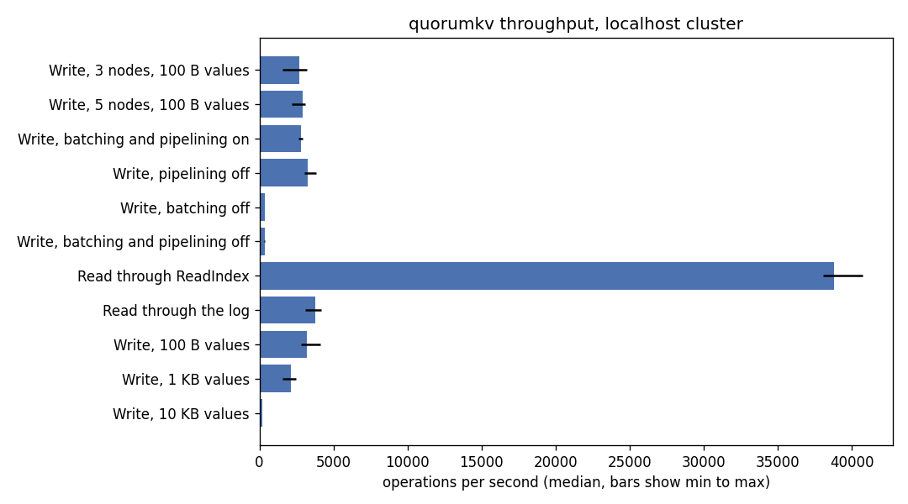
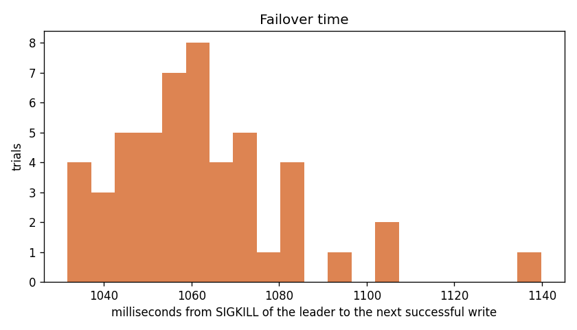
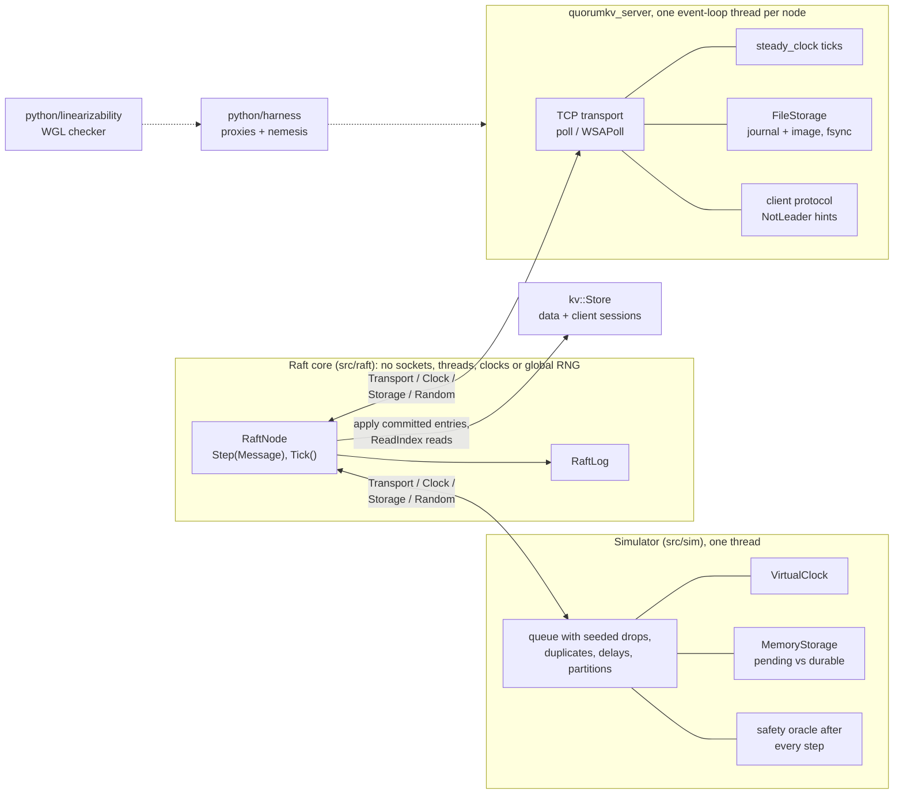

# quorumkv

quorumkv is a fault-tolerant, linearizable key-value store in C++20, replicated with Raft.
It supports Put, Get, Append and compare-and-swap. Client sessions make retried requests
apply exactly once, and reads are served through ReadIndex. The hard part of Raft is the cases
that almost never happen: a vote reply delayed past its term, a crash between replying and
syncing, or an old leader that does not know it was replaced. So the same Raft core runs in
two places. One is a deterministic simulator that injects drops, duplicates, long delays,
partitions, crashes and torn syncs, and checks Raft's safety properties after every simulated
step. The other is a cluster of real processes over TCP, attacked by a fault-injection harness,
whose client histories are checked by a linearizability checker.

The [project page](https://arnavlifelesscoder.github.io/quorumkv/) has a small interactive model
of the cluster to crash and partition, and the results below as charts. Its source is
`site/index.html`.

## Results

All numbers come from files in `results/`, produced by the scripts named next to them. The
performance numbers come from one Windows 11 machine (AMD Ryzen 9 8940HX, 16 cores and 32
threads, 15.1 GiB RAM, MSVC 19.44 at /O2). The cluster runs on localhost, so every node shares
that CPU and disk.

Correctness:

| Check | Result | Source |
| --- | --- | --- |
| Election safety, 10,000 seeds | no two leaders in a term, checked after each of 19.7 million steps | `results/m8/ci.json` |
| Replication safety, 10,000 seeds | Log Matching, State Machine Safety and Leader Completeness after each of 20.1 million steps | `results/m8/ci.json` |
| KV exactly-once and fresh reads with snapshots, 10,000 seeds | 175,018 operations, 34,870 snapshots and 141 installs, no duplicate or stale read | `results/m8/ci.json` |
| Real cluster under the nemesis | 20 five-minute runs, 703,109 operations, all linearizable, with 389 leader kills, 180 pauses and 414 partitions | `results/m6/campaign.json` |
| The checker finds real bugs | all 3 runs with `--unsafe-reads` flagged, with counterexamples of 3 to 4 operations | `results/m6/recheck.json` |

Performance (`bench/run_benchmarks.py`, rendered by `bench/report.py`; release build, 32
closed-loop clients, each configuration run 5 times):

| Benchmark | ops/sec (median, min to max) | p50 latency | p99 latency |
| --- | ---: | ---: | ---: |
| Write, 3 nodes, 100 B values | 2,694 (1,565 to 3,199) | 7.5 ms | 20.0 ms |
| Write, 5 nodes, 100 B values | 2,908 (2,163 to 3,077) | 7.8 ms | 20.2 ms |
| Write, batching and pipelining on | 2,787 (2,648 to 2,929) | 7.5 ms | 19.0 ms |
| Write, pipelining off | 3,281 (3,053 to 3,827) | 5.9 ms | 15.6 ms |
| Write, batching off | 361 (342 to 378) | 64.7 ms | 202.1 ms |
| Write, batching and pipelining off | 345 (339 to 389) | 62.9 ms | 1389.4 ms |
| Read through ReadIndex | 38,764 (38,025 to 40,724) | 0.8 ms | 1.2 ms |
| Read through the log | 3,764 (3,103 to 4,188) | 6.5 ms | 15.4 ms |
| Write, 100 B values | 3,225 (2,793 to 4,134) | 7.2 ms | 17.1 ms |
| Write, 1 KB values | 2,122 (1,578 to 2,444) | 11.3 ms | 54.3 ms |
| Write, 10 KB values | 190 (170 to 217) | 115.8 ms | 850.4 ms |
| New leader elected after SIGKILL of the leader, 50 trials | | 327 ms median | 686 ms p99 |
| First client write after SIGKILL of the leader, 50 trials | | 1059 ms median | 1140 ms p99 |
| Follower catch-up from at least 1,001,768 entries behind, 5 runs | | 0.5 s median | 0.3 to 1.0 s |

What the numbers show, and what they do not:

- **Differences under about 20% are noise on this machine.** The first, third and ninth rows
  are the same configuration, run as separate sets of five, and their medians are 2,694, 2,787
  and 3,225.

- **Batching is the main write optimization.** Turning it off cuts write throughput from 2,787
  to 361 operations per second, because every command then waits for its own fsync on the
  leader and on a follower.
- **Pipelining did not help here.** With it off, throughput was 3,281 (3,053 to 3,827), no
  lower than the pipelined runs and within the noise above. A plausible reason is that with one
  AppendEntries in flight, each follower write carries more entries, so followers do fewer and
  larger fsyncs. This has not been profiled. On a real network, where round trips cost more than
  a local fsync, the result may differ.
- **5 nodes are not measurably slower than 3** (2,908 vs 2,694, overlapping ranges). A commit still needs
  only the fastest majority, and every node shares one disk here.
- **ReadIndex reads are about 10 times faster than reads through the log** (38,764 vs 3,764),
  because they need one heartbeat round and no fsync.
- **10 KB values drop to 190 operations per second.** This has not been profiled. A likely
  factor is that each snapshot holds the whole map, about 10 MB at this size, and one is taken
  every 1,000 entries.
- **The election takes about a third of a second; clients see about one second.** A new leader
  is reported a median of 327 ms after the kill, which fits the 150 to 300 ms election timeout
  plus the polling interval. The first client write completes after a median of 1,059 ms,
  because the client spends its 1 s attempt timeout on the dead leader. On Windows, a
  connection to a closed localhost port takes about 2 s to be refused rather than failing at
  once.
- **Catch-up does not depend on the 1 million entries.** The follower is behind the leader's
  snapshot, so it installs one snapshot (1,000 keys of 100 B plus client sessions) and replays
  a short suffix. Catch-up time grows with the size of the state, not with the length of the
  history.






## Architecture



RaftNode only sees four interfaces: `Transport`, `Clock`, `Storage` and `Random`. The
simulator implements them with a seeded message queue, a virtual clock and in-memory storage
that separates pending from durable writes. The server implements them with TCP, a monotonic
clock and a journaled file store. Because the core is the same object in both, a failing
simulator seed replays exactly, and what the simulator verified is the code that serves
clients.

## Build and run

Requirements: CMake 3.20 or newer, Ninja, a C++20 compiler (MSVC 2022, GCC 12+ or Clang 15+),
and Python 3.11 or newer. GoogleTest is fetched at configure time.

```bash
git clone https://github.com/ArnavLifelessCoder/quorumkv.git
cd quorumkv
cmake --preset debug
cmake --build --preset debug
ctest --preset debug
```

The `asan` and `tsan` presets build with sanitizers (`tsan` is Linux only). On Windows, run
these from a Visual Studio x64 developer shell.

Run a three-node cluster and talk to it:

```bash
cmake --preset release && cmake --build --preset release
python -m venv .venv && .venv/bin/python -m pip install psutil pytest
cd python
../.venv/bin/python -m harness.run --server ../build/release/quorumkv_server \
    --client ../build/release/quorumkv_client --seed 1 --duration 60 --out ../build/runs/seed-1
```

The harness starts the servers, runs clients and the nemesis, and prints whether the history is
linearizable. `quorumkv_client --nodes host:port,... put k v` (also `get`, `append`, `cas`,
`status`) talks to a running cluster directly. Replay a simulator seed with
`build/debug/quorumkv_tests --gtest_filter=KvFuzz.Exactly* --seed=42`; every failure prints its
own replay command. [Development notes](docs/development.md) cover lint, clang-tidy and the
evidence scripts.

## Design decisions

- **One Raft core behind injected interfaces, over a separate simulated implementation.**
  The simulator then tests the exact code that runs in production. A failing seed is a complete
  reproduction, not a hint.
- **ReadIndex over leader leases.** Leases are faster but depend on bounded clock drift. A
  ReadIndex read costs one heartbeat round and is correct with any clock. See
  [the KV design](docs/kv.md) for why reading leader memory directly is not linearizable.
- **Exactly-once through sessions in the replicated state machine, over deduplication at the
  server.** Every replica, and every snapshot, carries the same per-client sequence and cached
  reply, so a retry is recognized no matter which leader receives it.
- **One event-loop thread per server, over a thread pool.** Raft is sequential at its core, so
  threads would add locking without adding throughput on this workload. Several servers still
  run in one test process, which TSan checks.
- **An append-only journal with periodic image compaction, over rewriting a full image.**
  The first version rewrote the whole retained log on every write. The journal appends and
  syncs one checksummed record per batch, and a torn final record is detected and dropped.
- **Per-link TCP proxies for network faults, over iptables.** They need no root, and blocking
  one proxy cuts exactly one direction of one link.

## Testing approach

- **Differential tests.** The codec is checked against an independent reference encoder, the
  file store against the in-memory store, and the linearizability checker against a
  brute-force search over every real-time order.
- **Deterministic simulation.** Each campaign runs 10,000 seeds of elections, replication and
  the KV workload, with drops, duplicates, reordering, delays longer than election timeouts,
  partitions, crashes, failures before and after sync, and power loss right after a reply is
  sent. Election safety, Log Matching, State Machine Safety, Leader Completeness, snapshot
  consistency and per-key history checks run after every step. A failing seed prints a replay
  command and its full trace.
- **Mutation testing.** Deliberately broken Raft variants are built as separate test binaries
  and must be caught by the simulator, and broken KV stores must be caught by the history
  checker (see below).
- **Crash and corruption tests for storage.** Process loss is injected at every sync and rename
  boundary; torn tails, single-byte corruption and truncation are all exercised.
- **Real-process fault injection.** Clusters of 3 and 5 processes run under partitions,
  one-way cuts, delays, SIGKILL of the leader and process pauses, and every history is checked
  for linearizability.
- **Sanitizers and CI.** Every push builds and tests debug and ASan on Windows and Linux and
  TSan on Linux, and runs clang-tidy, clang-format, ruff and pytest.

## Bugs found by the simulator and the other checks

The seeded campaigns have not found a safety bug in the Raft core as committed; each check was
first shown to catch deliberately injected defects. The seeds below are the first that expose
each injected defect:

| Injected defect | Caught by | First failing seed | Source |
| --- | --- | ---: | --- |
| Counting vote replies from an earlier term | election simulator, after delays past the term were added | 216 | `results/m2/summary.json` |
| Replying to a vote before saving it | election simulator, after power loss after replies was added | 217 | `results/m2/summary.json` |
| Saving the self-vote after sending RequestVote | replication simulator | 1 | `results/m3/summary.json` |
| Committing an entry from an earlier term (Figure 8) | replication simulator with the Figure 8 schedule | 7 | `results/m3/summary.json` |
| Acknowledging AppendEntries before saving | replication simulator | 6 | `results/m3/summary.json` |
| Voting twice in one term | replication simulator | 7 | `results/m3/summary.json` |
| Treating 2 of 5 votes as a majority | replication simulator | 7 | `results/m3/summary.json` |
| Serving reads from local state on any node | KV history checker | 4 | `results/m8/ci.json` |
| A store that forgets client sessions | KV history checker | 0 | `results/m8/ci.json` |
| Snapshots that drop the session table | snapshot replay check | 1 | `results/m8/ci.json` |
| `--unsafe-reads` on the real cluster | linearizability checker, all 3 runs | | `results/m6/recheck.json` |

Real bugs found during development, by other tests:

- The server's event loop accepted new connections before it had consumed every polled entry,
  and indexed past the end of its poll list. The three-server TCP test crashed on it.
- The checker's counterexample shrinking trimmed the history at the wrong operation, and later
  removed writes that remaining reads had observed. Its unit tests caught the first; the first
  real unsafe-reads history exposed the second.
- On Windows the journal was opened without write sharing, so reopening a data directory
  failed. The storage tests caught it.
- An early sender waited for an acknowledgement before sending the next replication batch. A
  unit test caught it.

## Limitations

- **One machine.** Every benchmark runs on localhost, so the numbers measure one CPU and one
  disk shared by all nodes, not a network. Threads are not pinned and turbo boost is not
  disabled.
- **Synchronous disk writes dominate write latency.** Every batch waits for an fsync on the
  leader and on a majority of followers.
- **No membership changes.** The cluster size is fixed at start, and there is no multi-Raft,
  sharding, transactions or TLS.
- **Uncommitted entries are not bounded.** Compaction covers committed history. A partitioned
  leader that keeps accepting writes grows its uncommitted log until it learns of the new term.
- **The state machine is an in-memory `std::map`.** Snapshots serialize all of it, so state
  must fit in memory and within the 64 MiB storage image limit.
- **Process pauses on Windows are thread suspension.** SIGSTOP and SIGCONT are used on Linux.
